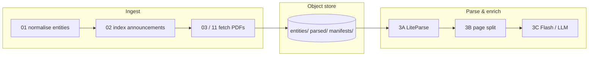

# ASX extraction pipeline

This document is the **canonical, living reference** for how Gypsy Danger ingests ASX filings, stores artefacts, and runs parse/enrichment stages. Update it whenever scripts, object keys, or stage boundaries change.

**Related:** [`spec.md`](spec.md) (research goals) · [`../plans/stage3-parse-enrichment.md`](../plans/stage3-parse-enrichment.md) (Stage 3 design detail) · [`../plans/neon-corpus-migration.md`](../plans/neon-corpus-migration.md) (S3 → Neon move)

---

## End-to-end flow



| Stage | Purpose | Primary scripts |
|-------|---------|-----------------|
| **0 — Entity list** | ASX ticker universe | `01_normalise_entities.py` |
| **1 — Index** | Markit announcement index per ticker | `02_index_announcements.py` |
| **2 — Fetch** | Download PDFs to object store | `03_fetch_documents.py`, `11_fetch_annual_reports_s3.py`, Phase C / CFO shards |
| **3A — LiteParse** | Layout-aware markdown + page JSON | `22_liteparse_document.py`, `23_liteparse_shard.py` |
| **3B — Split** | Per-page PDF/PNG + liteparse slice | `24_split_pdf_pages.py`, `25_split_shard.py` |
| **3C — Enrich** | Gemini / table extraction (planned) | TBD |
| **4 — Analysis** | Temporal graph, leakage signals | TBD |

Workers and EC2 orchestration live under `0-work/scripts/aws/` (fetch, parse, split). Those shells still pass `--bucket`; Python stages use the **object store layer** (`00_object_store.py`).

---

## Object store (AWS S3 or Neon)

**Same keys everywhere.** The corpus was built on `s3://gypsy-danger-asx-…/`; Neon uses bucket `asx-artifacts` (see root `neon.ts`) with **identical paths** inside the bucket.

| Variable | Meaning |
|----------|---------|
| `GYPSY_STORAGE_BUCKET` | Target bucket (`asx-artifacts` on Neon) |
| `GYPSY_S3_BUCKET` | Legacy name; still accepted |
| `GYPSY_STORAGE_BACKEND` | `aws` or `neon` (default: `neon` if `AWS_ENDPOINT_URL_S3` is set) |
| `AWS_ENDPOINT_URL_S3` | Neon branch S3 endpoint (from `neon env pull`) |
| `AWS_ACCESS_KEY_ID` / `AWS_SECRET_ACCESS_KEY` | Neon or AWS credentials |
| `AWS_REGION` | Region string (e.g. `ap-southeast-1`) |

**Library:** `0-work/scripts/00_object_store.py` — boto3 S3 API, path-style (required for Neon).

**Path helpers:** `0-work/scripts/00_asx_api.py` — functions named `s3_*_key` / `s3_*_prefix` return **backend-neutral keys** (historical naming).

---

## Object key layout

```
{bucket}/
  entities/{TICKER}/
    {TICKER}_Announcements.csv
    annual_reports/{YYYY}_{documentKey}.pdf
    cfo_changes/{YYYY-MM-DD}_{documentKey}.pdf
    … other corpus folders from CORPUS_REGISTRY …

  parsed/{TICKER}/{parse_folder}/{documentKey}/
    meta.json
    state.json
    liteparse/
      manifest.json          ← 3A idempotency guard
      document.md
      pages/{NNNN}/page.json, page.md
    pages/
      manifest.json          ← 3B idempotency guard
      {NNNN}/page.pdf, page.png, liteparse.json, liteparse.md
    flash/                   ← 3C (future)

  manifests/
    parse_enrich_progress.json
    parse_progress.json
    split_progress.json
    …

  parse_3a/                  ← shard lists, worker metadata
  catalog/                   ← query layer CSVs (future)
  scripts/                   ← worker bootstrap copies
  logs/
```

**Example parsed prefix:** `parsed/CBA/01_annual_reports/2924-02860163-2A1552191/`

**Corpus registry:** `CORPUS_REGISTRY` in `00_asx_api.py` maps logical corpus → parse folder (`01_annual_reports`, …) and fetch folder (`annual_reports`, …).

---

## Idempotency & manifests

| Guard object | Stage | Skip when present |
|--------------|-------|-------------------|
| `…/liteparse/manifest.json` | 3A | `--skip-if-exists` |
| `…/pages/manifest.json` | 3B | `--skip-if-exists` |
| PDF at `entities/…/*.pdf` | Fetch | head-object / `store.exists` |

Global progress: `manifests/parse_enrich_progress.json` (phase, counts, `ready_for_3b_data`, etc.). Per-run worker JSON under `parse_3a/` or `logs/`.

**Deferred / cleanup:** `manifests/parse/unavailable_cdn_pdfs.json` — CDN returned non-PDF for a small set of keys.

---

## Core extraction logic (by stage)

### Fetch

1. Load `{TICKER}_Announcements.csv` from object store (or local `data/entities/`).
2. Filter rows (annual report loose/strict, CFO tier A/B, etc.).
3. Download PDF from Markit CDN via `00_asx_api.py`.
4. Upload to `entities/{TICKER}/{corpus}/…` if missing.

### 3A — LiteParse (`22_liteparse_document.py`)

1. Download source PDF key (from meta or `s3_annual_report_key`).
2. Run LiteParse (markdown + per-page structure).
3. Write `meta.json`, `state.json`, `liteparse/**` under `parsed/…`.
4. Upload tree with `ObjectStore.upload_dir`.

### 3B — Page split (`24_split_pdf_pages.py`)

1. Require 3A (`liteparse/manifest.json`).
2. Optionally pull `liteparse/pages/` for page-level md/json.
3. PyMuPDF: single-page PDF + 300 DPI PNG per page; skip blank pages.
4. Update `state.json` → `3b_split.complete`; upload `pages/**`.

### 3C+ (not fully implemented)

Designed in `stage3-parse-enrichment.md`: Mastra + Gemini on page PNGs, `flash/` outputs, `usage.json`.

---

## Running locally

```bash
cd 0-work/scripts
pip install -r requirements-parse.txt

# Neon (after neon env pull → .env.local)
export GYPSY_STORAGE_BACKEND=neon
export GYPSY_STORAGE_BUCKET=asx-artifacts

python3 22_liteparse_document.py --ticker CBA --document-key … --published-date … --skip-if-exists
python3 24_split_pdf_pages.py --ticker CBA --document-key … --s3-pdf-key entities/CBA/annual_reports/… --skip-if-exists
```

Use `--output-dir` on either script to mirror layout under `data/parsed/` without uploading.

---

## Migrating corpus S3 → Neon

**Script:** `27_migrate_object_store.py`

```bash
# AWS creds for source; Neon creds from neon env pull in the same shell
export GYPSY_S3_BUCKET=gypsy-danger-asx-691811257790
export GYPSY_STORAGE_BUCKET=asx-artifacts
export GYPSY_STORAGE_BACKEND=neon   # for dest client when copying

python3 27_migrate_object_store.py \
  --source-backend aws --dest-backend neon \
  --dry-run   # then omit for real copy
```

Copies default prefixes: `entities/`, `parsed/`, `manifests/`, `parse_3a/`, `catalog/`, `data/`, `scripts/`, `logs/`, `cfo_changes/`. Skips objects when destination size matches source.

After cutover, point workers at Neon env vars only and retire EC2→S3 sync where replaced by Neon-native workers (see migration plan).

---

## Changelog

| Date | Change |
|------|--------|
| 2026-10-13 | Initial living doc; `00_object_store.py`; 3A/3B/fetch use boto3; `27_migrate_object_store.py`; Neon bucket `asx-artifacts` |

**When you change the pipeline:** add a row above, update stage tables, and link any new plan under `0-work/plans/`.
