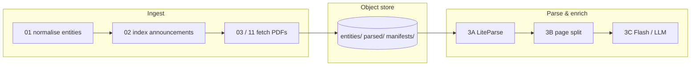
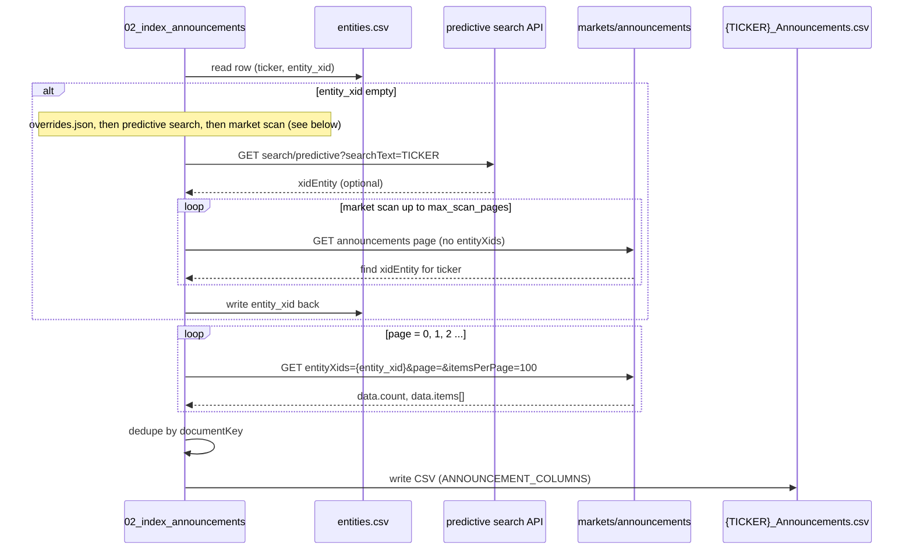
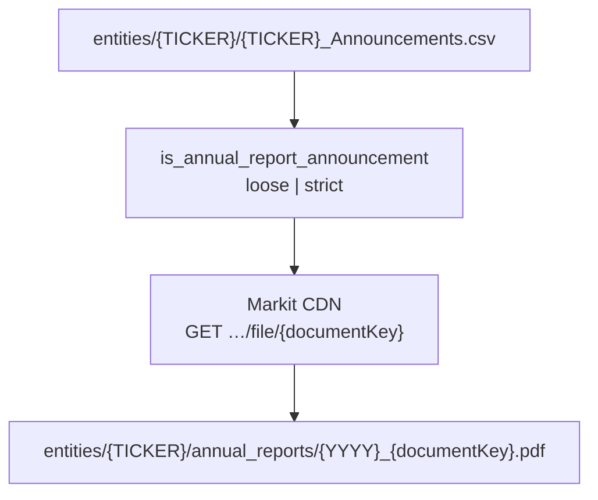

# ASX extraction pipeline

This document is the **canonical, living reference** for how Gypsy Danger ingests ASX filings, stores artefacts, and runs parse/enrichment stages. Update it whenever scripts, object keys, or stage boundaries change.

**Related:** [`spec.md`](spec.md) (research goals) · [`announcements-schema.md`](announcements-schema.md) (index CSV columns & annual filters) · [`links.md`](links.md) (API URLs) · [`../plans/plan.md`](../plans/plan.md) (Stage 1 execution) · [`../plans/stage3-parse-enrichment.md`](../plans/stage3-parse-enrichment.md) (Stage 3) · [`../plans/neon-corpus-migration.md`](../plans/neon-corpus-migration.md) (S3 → Neon)

**Shared library:** all ingest stages use `0-work/scripts/00_asx_api.py` (HTTP client, URLs, path helpers, filters).

---

## End-to-end flow



| Stage | Purpose | Primary scripts |
|-------|---------|-----------------|
| **0 — Entity list** | ASX ticker universe | `01_normalise_entities.py` |
| **1 — Index** | Markit announcement index per ticker | `02_index_announcements.py` |
| **2 — Fetch** | Download PDFs to object store | `03_fetch_documents.py`, `11_fetch_annual_reports_s3.py`, Phase C / CFO shards |
| **3A — LiteParse** | Layout-aware markdown + page JSON | `22_liteparse_document.py`, `23_liteparse_shard.py` |
| **3B — Split** | Per-page PDF/PNG + liteparse slice | `24_split_pdf_pages.py`, `25_split_shard.py` |
| **3C — Enrich** | Gemini / table extraction (planned) | TBD |
| **4 — Analysis** | Temporal graph, leakage signals | TBD |

Workers and EC2 orchestration live under `0-work/scripts/aws/` (fetch, parse, split). Those shells still pass `--bucket`; Python stages use the **object store layer** (`00_object_store.py`).

---

## Stage 0 — Entity list (normalise universe)

**Script:** `01_normalise_entities.py`  
**Purpose:** Build the single ticker-level table the rest of the pipeline reads.

### Inputs

| Input | Location | Notes |
|-------|----------|--------|
| ASX listed companies CSV | `0-work/docs/ASX_Listed_Companies_*.csv` (newest file by glob) | Same columns as [Markit directory export](links.md); optional `--source` override |
| Pilot filter (optional) | `data/pilot_tickers.txt` | With `--pilot-only`, only those tickers are kept |
| Existing `entity_xid` values | Prior `data/entities.csv` | **Preserved** on re-run so Step 2 does not re-resolve |

### Logic (exact)

1. Open source CSV; for each row read `ASX code` → **ticker** (uppercased, skip empty).
2. Map columns → output row:
   - `name` ← `Company name`
   - `gics_industry_group` ← `GICs industry group`
   - `listing_date` ← `Listing date`
   - `market_cap_aud` ← `Market Cap` (normalised via `normalise_market_cap`)
   - `entity_xid` ← preserved from old `entities.csv` if present, else `""`
3. Sort rows by `ticker`.
4. Write `data/entities.csv` with columns:  
   `ticker`, `name`, `gics_industry_group`, `listing_date`, `market_cap_aud`, `entity_xid`.

### Outputs (local)

```
data/entities.csv
```

No API calls in this step. Optional live directory URL exists (`companies/directory/file`) but the script uses the checked-in CSV by default.

---

## Stage 1 — Index announcements (Markit API → CSV)

**Script:** `02_index_announcements.py`  
**Purpose:** For each ticker, resolve **`entity_xid`** (if missing), then download **the full announcement history** for that entity and write one index CSV per company.

### Scope flags

- `--pilot-only` — only tickers in `data/pilot_tickers.txt`
- `--ticker CBA --ticker BHP` — explicit subset
- Default — every row in `data/entities.csv`

### Per-ticker algorithm



#### Step 1 — Resolve `entity_xid`

Order of attempts (`resolve_entity_xid` in `00_asx_api.py`):

1. **`data/overrides.json`** → `entity_xid["TICKER"]` if set (manual fix for edge cases).
2. **Predictive search** — `GET …/search/predictive?searchText={TICKER}`; first item where `symbol == TICKER` → `xidEntity`.
3. **Market scan fallback** — paginate `GET …/markets/announcements?page=N&itemsPerPage=100` **without** `entityXids`, up to `--max-scan-pages` (default **500**), until an item references the ticker (`symbol`, `symbolsSecondary`, or `companyInfo[].symbol`) and yields `xidEntity` from `companyInfo`.

Failure raises; ticker is logged to `data/logs/02_index_announcements.log` and the run continues with other tickers.

After each successful ticker, **`entity_xid` is merged back into `data/entities.csv`** (full file rewrite, sorted by ticker).

#### Step 2 — Paginate all announcements

`fetch_all_announcements(client, entity_xid)`:

- `page` starts at **0** (0-based).
- Each request:  
  `GET {MARKIT_BASE}/markets/announcements?entityXids={entity_xid}&page={page}&itemsPerPage=100`
- Append `data.items[]` to an in-memory list.
- Stop when:
  - `items` is empty, **or**
  - `len(all_items) >= data.count`, **or**
  - `len(items) < itemsPerPage` (last page).

**No announcement-type filter** at index time — the CSV holds the **complete** Markit history for that entity (often thousands of rows per ticker; full ASX corpus ≈ **1.26M** announcement rows).

#### Step 3 — Normalise rows

For each API item with a non-empty `documentKey`:

- Build one CSV row via `announcement_row(ticker, entity_xid, item)` — columns listed in [`announcements-schema.md`](announcements-schema.md).
- JSON subfields (`announcementTypes`, `companies`, `companyInfo`, `symbolsSecondary`) are stored as **JSON strings** in the CSV.

#### Step 4 — Dedupe and write

- **Dedupe:** keep first row per `documentKey` (`dedupe_by_document_key`).
- **Write:** `data/entities/{TICKER}/{TICKER}_Announcements.csv`  
  (legacy name `announcements.csv` is still read if present; `05_rename_announcements_csv.py` renames to the standard name).

### HTTP client behaviour (`AsxClient`)

- Default **1 s** minimum spacing between requests (`rate_limit_s`).
- JSON and binary responses cached under `data/cache/` (SHA-256 of URL) unless `--no-cache`.
- Retries: up to **3** attempts with exponential backoff on HTTP/URL errors.

### Outputs

| Artifact | Path |
|----------|------|
| Updated entity ids | `data/entities.csv` |
| Per-ticker index | `data/entities/{TICKER}/{TICKER}_Announcements.csv` |
| Run audit | `data/logs/02_index_announcements.log` |

**Production mirror:** index CSVs are synced to object store as  
`entities/{TICKER}/{TICKER}_Announcements.csv` (same columns, same rows).

---

## Stage 2 — Fetch PDFs (CDN download)

Two fetch paths share the same **CDN URL** and **row selection** helpers but differ in **where PDFs land on disk/object store**.

| Path | Script | Typical use | PDF location |
|------|--------|-------------|----------------|
| **Local / pilot** | `03_fetch_documents.py` | Stage 1 test, laptop | `data/entities/{TICKER}/raw/{safe_documentKey}.pdf` |
| **Object store / scale** | `11_fetch_annual_reports_s3.py` (+ EC2 shards `12_*`, `16_*`, …) | Full ASX annual corpus | `entities/{TICKER}/annual_reports/{YYYY}_{documentKey}.pdf` |

`safe_documentKey` = `documentKey` with `/` → `_` (`safe_document_key`).

### CDN download (both paths)

For each selected `documentKey`:

```
GET https://cdn-api.markitdigital.com/apiman-gateway/ASX/asx-research/1.0/file/{documentKey}&v=undefined
```

Built by `cdn_pdf_url(document_key)` in `00_asx_api.py`.  
Download via `AsxClient.get_bytes(url)` (same cache, rate limit, retries as indexing).

### Row selection — annual reports

Filtering is **not** done at index time; fetch scripts read the announcements CSV and apply `is_annual_report_announcement(row, mode=…)`:

| Mode | Rule |
|------|------|
| **`loose`** | `"Annual Report"` ∈ `announcementTypes` (parsed from JSON column) |
| **`strict`** | loose **and** headline not matching exclude regex (Shareholder Review, Form 20-F, sustainability summary, etc.) **and** (any **full-year co-tag** — e.g. `Full Year Accounts`, `Preliminary Final Report` — **or** headline matches `annual report` / `appendix 4e`) |

Full corpus counts (indexed Jul 2026): **~22,573 loose** / **~22,128 strict** annual-report rows vs **~1,260,035** total announcement rows. Details: [`announcements-schema.md`](announcements-schema.md).

Other corpora (e.g. **CFO changes**) use separate fetch scripts and `CORPUS_REGISTRY` keys — same index CSV, different filters and object key patterns (`cfo_changes/{YYYY-MM-DD}_{documentKey}.pdf`).

---

### Path A — `03_fetch_documents.py` (local)

**Command example:**

```bash
python3 0-work/scripts/03_fetch_documents.py --pilot-only --annual-reports-only --annual-filter loose
```

**Per-ticker loop:**

1. Require `data/entities/{TICKER}/{TICKER}_Announcements.csv` (from Stage 1).
2. For each CSV row:
   - If `--annual-reports-only`, skip row when `is_annual_report_announcement` is false.
   - Skip if no `documentKey`.
   - Destination: `data/entities/{TICKER}/raw/{safe_documentKey}.pdf`.
   - **Idempotent skip:** file exists and `size >= --min-bytes` (default **50 KiB**, `MIN_PDF_BYTES`).
   - Else `GET` CDN URL; if `len(content) < min_bytes`, count as **fail** (too small / not PDF).
   - On success, write bytes to `dest`.
3. Append outcomes to **`data/fetch_log.json`**: arrays `success`, `skipped`, `failed` with ticker, document_key, url, error.

**CDN “IP burn” handling:** optional `CdnBurnTracker` — stops the ticker loop (exit code **2**) if rolling **429/503** rate or consecutive **429**s exceed thresholds (`--burn-error-pct`, `--burn-consecutive-429`). Used on EC2 workers before rotation.

**Note:** Local layout uses **`raw/`** and flat `{documentKey}.pdf` names — not the `{YYYY}_` prefix used on object store.

---

### Path B — `11_fetch_annual_reports_s3.py` (object store)

**Command example (worker):**

```bash
python3 0-work/scripts/11_fetch_annual_reports_s3.py \
  --ticker CBA --bucket "$GYPSY_STORAGE_BUCKET" \
  --annual-filter loose --skip-if-exists  # implicit via head object
```

**Per-ticker loop:**

1. Load announcements CSV:
   - `--announcements-source s3` (default): read  
     `entities/{TICKER}/{TICKER}_Announcements.csv` from bucket via `00_object_store`.
   - `--announcements-source local`: read from `data/entities/…` on disk.
2. Build target list: `annual_report_rows(rows, mode=annual_filter, start_offset=…)` — same strict/loose logic as above; optional `--max-reports`, `--start-offset` for sharded workers.
3. For each target row:
   - `document_key` from CSV; `date` for year prefix.
   - Object key: **`entities/{TICKER}/annual_reports/{YYYY}_{documentKey}.pdf`**  
     (`s3_annual_report_key` — year = first 4 chars of ISO `date`).
   - **Idempotent skip:** `store.exists(s3_key)` → count as skipped, no download.
   - Else download CDN bytes; validate with **`is_valid_pdf`** (starts with `%PDF`, ≥ **1024** bytes magic check — allows smaller real PDFs below 50 KiB).
   - Upload via `store.put_bytes(s3_key, content)`.
4. Write worker **`result_json`** (upload counts, keys, burn stats, `complete` flag) for EC2 orchestration.

**Distributed fetch:** Phase C (`12_fetch_phase_c_shard.py`, `12_build_phase_c_shards.py`, `aws/run_*`) splits tickers across many EC2 instances; each runs `11_fetch_annual_reports_s3.py` with a shard file and rotation offsets. Same object key layout.

---

### Stage 2 data flow (production)



### Stage 0–2 local vs object store

| Stage | Local path (dev) | Object store key (production) |
|-------|------------------|-------------------------------|
| 0 | `data/entities.csv` | often copied to bucket root / `data/` (optional) |
| 1 | `data/entities/{TICKER}/{TICKER}_Announcements.csv` | `entities/{TICKER}/{TICKER}_Announcements.csv` |
| 2 (pilot) | `data/entities/{TICKER}/raw/*.pdf` | — |
| 2 (scale) | — | `entities/{TICKER}/annual_reports/{YYYY}_{documentKey}.pdf` |

Parse Stage **3A** reads PDFs from the **object store** layout (`entities/…/annual_reports/…`), not from local `raw/`.

---

## Object store (AWS S3 or Neon)

**Same keys everywhere.** The corpus was built on `s3://gypsy-danger-asx-…/`; Neon uses bucket `asx-artifacts` (see root `neon.ts`) with **identical paths** inside the bucket.

| Variable | Meaning |
|----------|---------|
| `GYPSY_STORAGE_BUCKET` | Target bucket (`asx-artifacts` on Neon) |
| `GYPSY_S3_BUCKET` | Legacy name; still accepted |
| `GYPSY_STORAGE_BACKEND` | `aws` or `neon` (default: `neon` if `AWS_ENDPOINT_URL_S3` is set) |
| `AWS_ENDPOINT_URL_S3` | Neon branch S3 endpoint (from `neon env pull`) |
| `AWS_ACCESS_KEY_ID` / `AWS_SECRET_ACCESS_KEY` | Neon or AWS credentials |
| `AWS_REGION` | Region string (e.g. `ap-southeast-1`) |

**Library:** `0-work/scripts/00_object_store.py` — boto3 S3 API, path-style (required for Neon).

**Path helpers:** `0-work/scripts/00_asx_api.py` — functions named `s3_*_key` / `s3_*_prefix` return **backend-neutral keys** (historical naming).

---

## Object key layout

```
{bucket}/
  entities/{TICKER}/
    {TICKER}_Announcements.csv
    annual_reports/{YYYY}_{documentKey}.pdf
    cfo_changes/{YYYY-MM-DD}_{documentKey}.pdf
    … other corpus folders from CORPUS_REGISTRY …

  parsed/{TICKER}/{parse_folder}/{documentKey}/
    meta.json
    state.json
    liteparse/
      manifest.json          ← 3A idempotency guard
      document.md
      pages/{NNNN}/page.json, page.md
    pages/
      manifest.json          ← 3B idempotency guard
      {NNNN}/page.pdf, page.png, liteparse.json, liteparse.md
    flash/                   ← 3C (future)

  manifests/
    parse_enrich_progress.json
    parse_progress.json
    split_progress.json
    …

  parse_3a/                  ← shard lists, worker metadata
  catalog/                   ← query layer CSVs (future)
  scripts/                   ← worker bootstrap copies
  logs/
```

**Example parsed prefix:** `parsed/CBA/01_annual_reports/2924-02860163-2A1552191/`

**Corpus registry:** `CORPUS_REGISTRY` in `00_asx_api.py` maps logical corpus → parse folder (`01_annual_reports`, …) and fetch folder (`annual_reports`, …).

---

## Idempotency & manifests

| Guard object | Stage | Skip when present |
|--------------|-------|-------------------|
| `…/liteparse/manifest.json` | 3A | `--skip-if-exists` |
| `…/pages/manifest.json` | 3B | `--skip-if-exists` |
| PDF at `entities/…/*.pdf` | Fetch | head-object / `store.exists` |

Global progress: `manifests/parse_enrich_progress.json` (phase, counts, `ready_for_3b_data`, etc.). Per-run worker JSON under `parse_3a/` or `logs/`.

**Deferred / cleanup:** `manifests/parse/unavailable_cdn_pdfs.json` — CDN returned non-PDF for a small set of keys.

---

## Core extraction logic — parse stages (3+)

### 3A — LiteParse (`22_liteparse_document.py`)

1. Download source PDF key (from meta or `s3_annual_report_key`).
2. Run LiteParse (markdown + per-page structure).
3. Write `meta.json`, `state.json`, `liteparse/**` under `parsed/…`.
4. Upload tree with `ObjectStore.upload_dir`.

### 3B — Page split (`24_split_pdf_pages.py`)

1. Require 3A (`liteparse/manifest.json`).
2. Optionally pull `liteparse/pages/` for page-level md/json.
3. PyMuPDF: single-page PDF + 300 DPI PNG per page; skip blank pages.
4. Update `state.json` → `3b_split.complete`; upload `pages/**`.

### 3C+ (not fully implemented)

Designed in `stage3-parse-enrichment.md`: Mastra + Gemini on page PNGs, `flash/` outputs, `usage.json`.

---

## Running locally

```bash
cd 0-work/scripts
pip install -r requirements-parse.txt

# Neon (after neon env pull → .env.local)
export GYPSY_STORAGE_BACKEND=neon
export GYPSY_STORAGE_BUCKET=asx-artifacts

python3 22_liteparse_document.py --ticker CBA --document-key … --published-date … --skip-if-exists
python3 24_split_pdf_pages.py --ticker CBA --document-key … --s3-pdf-key entities/CBA/annual_reports/… --skip-if-exists
```

Use `--output-dir` on either script to mirror layout under `data/parsed/` without uploading.

---

## Migrating corpus S3 → Neon

**Scripts:** `27_migrate_object_store.py` (serial copy). For a **manifest + Cloudflare/Vercel queue worker** design, see [`../plans/neon-corpus-migration-queue-workers.md`](../plans/neon-corpus-migration-queue-workers.md).

```bash
# AWS creds for source; Neon creds from neon env pull in the same shell
export GYPSY_S3_BUCKET=gypsy-danger-asx-691811257790
export GYPSY_STORAGE_BUCKET=asx-artifacts
export GYPSY_STORAGE_BACKEND=neon   # for dest client when copying

python3 27_migrate_object_store.py \
  --source-backend aws --dest-backend neon \
  --dry-run   # then omit for real copy
```

Copies default prefixes: `entities/`, `parsed/`, `manifests/`, `parse_3a/`, `catalog/`, `data/`, `scripts/`, `logs/`, `cfo_changes/`. Skips objects when destination size matches source.

After cutover, point workers at Neon env vars only and retire EC2→S3 sync where replaced by Neon-native workers (see migration plan).

---

## Changelog

| Date | Change |
|------|--------|
| 2026-10-13 | Link queue-worker migration plan (manifest checklist on Neon) |
| 2026-10-13 | Document Stages 0–2: entity normalisation, Markit index pagination, entity_xid resolution, local vs S3 fetch paths, annual filters |
| 2026-10-13 | Initial living doc; `00_object_store.py`; 3A/3B/fetch use boto3; `27_migrate_object_store.py`; Neon bucket `asx-artifacts` |

**When you change the pipeline:** add a row above, update stage tables, and link any new plan under `0-work/plans/`.
