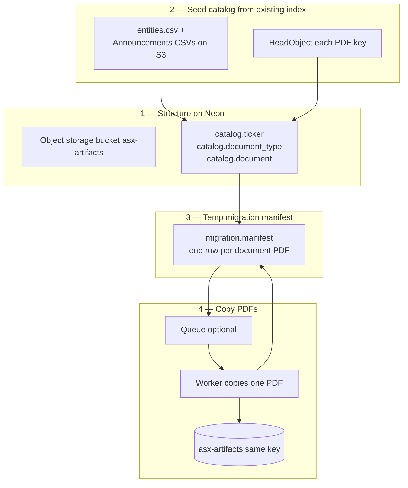

# Neon corpus migration — structure, then document manifest

**Status:** Draft. Replaces the earlier “copy every S3 object” checklist.

**Goal:** Put the **company / document catalog** on Neon Postgres, then copy **source PDFs only** into Neon Object Storage (`asx-artifacts`), tracked by a **temporary migration manifest**. Derived parse output, the S3 `catalog/` prefix, and worker `scripts/` stay on AWS.

---

## Verdict on the proposed shape

The shape is right:

1. Neon structure first (bucket + permanent tables).
2. A migration manifest that marks each **document** complete.
3. Do not migrate `parsed/`, `catalog/`, or `scripts/`.

Two adjustments keep it correct:

- **Ticker, document type, and document are the permanent catalog**, not the temp database. They replace `catalog/*.csv` and are what later stages query. The temp piece is only the manifest (and its run metadata). Put that in schema `migration` on the **same** GypsyDanger database so it can foreign-key to `document` and be dropped after cutover. A second Neon project would duplicate company and document rows.
- **Document type is the storage corpus** (`annual_reports`, `cfo_changes`, …), one per PDF path. Markit `announcementTypes` is a separate multi-label list on the filing (Annual Report and Full Year Accounts on the same PDF). That list can live as JSON on `document` for now. It is not the migration unit.

The manifest row is one **source PDF**, not one S3 object under `parsed/`. Stage 3A/3B artefacts are rebuilt later from the PDF on Neon. That is a recompute (LiteParse + page split), not a copy. ~22,570 annual reports and ~1.8M pages of 3A output stay behind on purpose.

---

## What moves

| On AWS today | Move? | Why |
|--------------|-------|-----|
| `entities/{TICKER}/annual_reports/{YYYY}_{documentKey}.pdf` | Yes | Source annual-report PDF |
| `entities/{TICKER}/cfo_changes/{YYYY-MM-DD}_{documentKey}.pdf` | Yes, if that corpus is in scope | Source event PDF |
| `{TICKER}_Announcements.csv` and `entities.csv` | Read once to seed Postgres | After load, Postgres is the catalog |
| `parsed/…` (3A LiteParse, 3B pages) | No | Re-run parse on Neon PDFs |
| `catalog/` | No | Replaced by the tables below |
| `scripts/`, `logs/`, worker progress JSON | No | Ops artefacts, not the corpus |

Index rows that were never downloaded (~1.26M announcements vs ~22k annual PDFs) can be inserted as catalog documents later. **The manifest includes only documents whose PDF exists on the source bucket.**

---

## Order of work

1. **Structure on Neon** — `neon deploy` so production has Postgres and bucket `asx-artifacts`. Apply the `catalog` schema. Empty prefixes do not need to be pre-created; keys appear on first put.
2. **Seed the catalog** — load companies and the documents that have PDFs. Record `source_object_key`, size, and ETag from S3 `HeadObject`.
3. **Open the temp manifest** — one `pending` row per catalog document that has a source PDF.
4. **Copy** — worker reads AWS, writes the same key on Neon, checks size (and ETag when comparable), sets manifest `complete`.
5. **Gate** — cut over when every manifest row is `complete` or an explicit `waived` (known missing CDN PDFs).
6. **Drop** schema `migration` after the pipeline reads Neon. Keep `catalog`.

Queue (Cloudflare or Vercel) is an optional dispatcher in step 4. The manifest is the state. The queue is how work is handed out. A single machine draining `pending` rows is valid until volume needs fan-out.

---

## Permanent catalog (`catalog`)

Same GypsyDanger project, production branch.

### `catalog.ticker`

One ASX company. Seed from `data/entities.csv`.

| Column | Notes |
|--------|--------|
| `id` | uuid PK |
| `symbol` | unique, e.g. `CBA` |
| `name` | company name |
| `entity_xid` | Markit id used to paginate announcements |
| `gics_industry_group` | optional |
| `listing_date` | optional |
| `market_cap_aud` | optional |

### `catalog.document_type`

One pipeline corpus. Seed from `CORPUS_REGISTRY` in `00_asx_api.py` (the same list as `catalog/corpus_registry.csv`).

| Column | Notes |
|--------|--------|
| `id` | smallint or text PK |
| `key` | unique: `annual_reports`, `cfo_changes`, … |
| `corpus_id` | `01`, `05`, … |
| `fetch_folder` | `annual_reports` |
| `parse_folder` | `01_annual_reports` (used when 3A is re-run; not migrated now) |

### `catalog.document`

One filing PDF the corpus cares about.

| Column | Notes |
|--------|--------|
| `id` | uuid PK |
| `ticker_id` | FK → ticker |
| `document_type_id` | FK → document_type |
| `document_key` | Markit `documentKey` |
| `published_at` | announcement `date` |
| `headline` | |
| `announcement_types` | jsonb — Markit tags, many per PDF |
| `source_object_key` | e.g. `entities/CBA/annual_reports/2024_{documentKey}.pdf` |
| `byte_size` | from S3 head, nullable until confirmed |
| `source_etag` | from S3 head |

Unique: `(document_type_id, document_key)`. A PDF lives in one corpus folder. `document_key` alone is unique in practice; the pair matches the path.

This table is the catalog. It does not store copy progress.

---

## Temporary manifest (`migration`)

Drop this schema after cutover.

### `migration.run`

| Column | Notes |
|--------|--------|
| `id` | uuid PK |
| `started_at` | |
| `source_bucket` | legacy AWS bucket |
| `dest_bucket` | `asx-artifacts` |
| `status` | `open` \| `complete` |

### `migration.manifest`

One row per document to copy. This is the checklist.

| Column | Notes |
|--------|--------|
| `id` | uuid PK |
| `run_id` | FK → run |
| `document_id` | unique per run, FK → `catalog.document` |
| `status` | `pending` \| `in_progress` \| `complete` \| `failed` \| `waived` |
| `attempts` | |
| `dest_etag` | after put |
| `dest_byte_size` | must match `catalog.document.byte_size` |
| `last_error` | |
| `completed_at` | |

`complete` means the PDF bytes are on Neon at `source_object_key` and the size matches. `waived` is for the known CDN gaps (no PDF to copy). Those documents stay in the catalog with a null or absent object.

Workers claim `pending` → `in_progress`, copy, then `complete` or `failed`. Re-queue `failed` until `attempts` hits a cap.

---

## Copy worker

For one manifest row:

1. Read `catalog.document.source_object_key`.
2. GET the object from the AWS bucket.
3. PUT the same key to `asx-artifacts`.
4. Head the destination. Size must equal `byte_size`.
5. Set manifest `complete`.

Idempotent: if destination size already matches, mark `complete` and skip the download.

Dispatcher options, unchanged in spirit from the earlier draft:

- Cloudflare Queue + Worker, or Vercel Queue + Function, or a single process selecting `pending` rows.
- Concurrency stays low until Neon rate limits are observed.
- AWS credentials on the worker are read-only on the source bucket. Neon storage credentials write `asx-artifacts`.

Large PDFs must fit the worker body/time limit. If they do not, that worker class is the wrong host and the drainer should be a small VM that still updates the same manifest.

---

## Done when

- Every `migration.manifest` row for the open run is `complete` or `waived`.
- Count of `complete` annual-report PDFs matches S3 `entities/*/annual_reports/*.pdf` (about 22,570, minus waived keys).
- Spot-check a handful of keys: size on Neon equals `catalog.document.byte_size`.
- Pipeline env points at `asx-artifacts` for new fetches and for a later 3A re-parse.
- Schema `migration` is dropped. Schema `catalog` remains.

`parsed/` on AWS can be deleted only after a Neon 3A/3B run replaces it, or kept as a cold archive until that re-parse exists.

---

## Out of scope for this migration

- Copying `parsed/`, `catalog/`, `scripts/`, `logs/`.
- Stage 3C enrichment.
- Loading all ~1.26M announcement rows that have no PDF. Add them to `catalog.document` in a later index load if the catalog must list every filing, not every file.

---

## Changelog

| Date | Change |
|------|--------|
| 2026-10-13 | Rework: catalog tables first (ticker, document type, document); temp `migration.manifest` per PDF; skip parse, catalog prefix, and scripts |
| 2026-10-13 | Initial draft: object-level inventory and queue workers |
