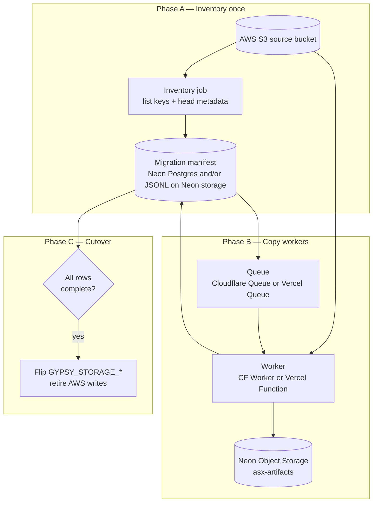

# Neon corpus migration — manifest checklist + edge workers

**Status:** Draft idea — alternative to **Phase 1** in [`neon-corpus-migration.md`](neon-corpus-migration.md) (single-machine `27_migrate_object_store.py`).

**Goal:** Treat migration as a **durable, resumable job**: inventory every object on AWS S3 → store a **migration manifest / checklist** on Neon → copy objects **one-by-one** via serverless workers → mark each row complete → cut over when the checklist is done.

Object **keys stay identical**; only bucket/host changes (`asx-artifacts` on Neon).

---

## Why not only one serial Python process?

| Concern | Serial `27_migrate_*` | Manifest + workers |
|---------|----------------------|---------------------|
| Runtime | Days; fragile if VM dies | Resumable from last ack |
| Throughput | One TCP stream | Tunable concurrency (with rate limits) |
| Observability | Run summary JSON | Per-object state + dashboards |
| Verification | Size skip only | ETag/checksum + explicit `complete` |
| Cost | One big EC2 | Pay per message + small worker CPU |

A **hybrid** is fine: inventory + manifest on Neon first, then workers (or a fleet of EC2 shards) drain the queue.

---

## Architecture (target)



---

## Migration manifest (checklist)

**Source of truth** for “what must exist on Neon.” Two layers (pick one or both):

### Option 1 — Neon Postgres (recommended for queries)

Table on **production** branch (Lakebase Postgres), e.g. `migration.object_copy`:

| Column | Purpose |
|--------|---------|
| `object_key` | PK — same key as S3 (`entities/CBA/annual_reports/…`) |
| `source_bucket` | Legacy AWS bucket name |
| `source_etag` | From S3 `HeadObject` |
| `source_size` | `ContentLength` |
| `dest_bucket` | `asx-artifacts` |
| `dest_etag` | After successful put |
| `status` | `pending` \| `in_progress` \| `complete` \| `failed` \| `skipped` |
| `attempts` | Retry count |
| `last_error` | Truncated message |
| `updated_at` | ISO timestamp |
| `run_id` | Migration run uuid |

Indexes: `(status)`, `(run_id, status)` for worker dequeue.

**Why Postgres:** cheap aggregations (`count(*) where status=complete`), admin UI later, same Neon project as future catalog.

### Option 2 — Object manifest on Neon storage

- `manifests/migration/{run_id}/inventory.jsonl` — one JSON line per object at inventory time.
- `manifests/migration/{run_id}/progress.json` — rolling counters + phase.
- Workers append to `manifests/migration/{run_id}/failures.jsonl` on error.

**Why object store:** no schema migration; workers only need S3 API + one JSON file read. Harder to query “how many pending?” without scanning.

**Pragmatic split:** Postgres for **state**; optional JSONL **audit export** for debugging.

---

## Phase A — Build inventory (run once per migration)

1. **List** all keys under prefixes (same as `DEFAULT_PREFIXES` in `00_object_store.py`):
   - `entities/`, `parsed/`, `manifests/`, `parse_3a/`, `catalog/`, `data/`, `scripts/`, `logs/`, …
2. For each key, **HeadObject** on AWS: `ContentLength`, `ETag`, optional `ContentType`.
3. **Skip** zero-byte keys or known junk if any.
4. **Insert** rows `status=pending` (Postgres) or append JSONL line.
5. Upload **`manifests/migration/{run_id}/inventory_meta.json`** to Neon (counts, prefixes, started_at, source bucket).

**Tooling options:**

- Extend `27_migrate_object_store.py` with `--inventory-only --manifest-run-id …` (writes Postgres or JSONL).
- One-off script `28_build_migration_inventory.py` (future).
- AWS S3 Inventory report → transform → load Postgres (cheapest at huge scale; slower to set up).

**Copy existing pipeline manifest first (fast win):**

- Sync `manifests/parse_enrich_progress.json`, shard lists under `parse_3a/`, and `catalog/corpus_registry.csv` to Neon **before** bulk object copy so ops can see corpus state on the new bucket while migration runs.

---

## Phase B — Queue + workers (stateful copy)

### Message shape (queue)

```json
{
  "run_id": "uuid",
  "object_key": "entities/CBA/annual_reports/2024_….pdf",
  "source_etag": "\"abc…\"",
  "source_size": 1234567
}
```

Optional: batch messages (e.g. 10 keys) to reduce queue overhead — tradeoff vs failure blast radius.

### Worker logic (CF Worker or Vercel Function)

For each message:

1. **Claim** row in Postgres: `pending` → `in_progress` (or rely on queue at-least-once + idempotent dest check).
2. **GET** object from AWS S3 (worker needs **read-only IAM** or pre-signed GET URLs generated at inventory time).
3. **PUT** to Neon Object Storage (`AWS_ENDPOINT_URL_S3` + branch creds, path-style, same `object_key`).
4. **Verify:** compare `ContentLength`; prefer **ETag** match if Neon returns comparable ETag.
5. **Mark** `complete` (store dest ETag) or `failed` with error; increment `attempts`.
6. **Ack** queue message only after step 5 success (or move to DLQ after N attempts).

**Secrets:**

- AWS: access key scoped to `s3:GetObject`, `s3:ListBucket` on source bucket only.
- Neon: storage credentials from branch (rotate via Neon; not in git).

**Concurrency:**

- Start **low** (5–20 concurrent workers) to avoid Neon 429 / rate limits; increase from metrics.
- Large PDFs: stream body through worker (memory limit — CF Workers have caps; **Vercel** or **CF R2 intermediary** may be needed for multi‑100MB objects; annual reports are usually smaller).

### Cloudflare Queue vs Vercel Queue

| | Cloudflare Queue + Worker | Vercel Queue + Function |
|--|---------------------------|-------------------------|
| **Stateful retries** | Built-in DLQ, visibility timeout | Vercel queue retry policy |
| **Long transfers** | CPU/time limits — may need multipart or bypass for huge objects | Function max duration — same concern |
| **S3 → Neon path** | Worker fetches AWS, puts Neon | Same |
| **Ops** | CF dashboard, queue depth | Vercel dashboard |
| **Fit** | High fan-out, edge | Already on Vercel for app |

**Not sure yet?** Prototype with **1000 messages** on one prefix (`manifests/`) before full corpus.

### Alternative: Neon Function as worker

Same queue consumer logic on **Neon Functions** (close to storage region). Pros: one vendor, creds injected. Cons: cold start, concurrency limits — evaluate against CF/Vercel.

---

## Phase C — Completion gate & cutover

**Do not flip production** until:

- [ ] `count(complete) = count(pending+complete+failed)` and `failed = 0` (or failed keys documented/waived).
- [ ] Spot verify: N random keys — size + ETag match AWS vs Neon.
- [ ] Document-level check: count `entities/*/annual_reports/*.pdf` on both sides ≈ 22,570 (minus known CDN gaps).
- [ ] `manifests/migration/{run_id}/complete.json` written with signer + timestamp.
- [ ] Update `manifests/parse_enrich_progress.json` URIs from `s3://…` to `neon://asx-artifacts/…` (or neutral `storage://`).

Then: [`neon-corpus-migration.md`](neon-corpus-migration.md) **Phase 2** (pipeline env) and **Phase 4** (AWS read-only / decommission).

---

## Open decisions

| # | Question | Notes |
|---|----------|--------|
| 1 | Postgres vs JSONL-only manifest | Postgres better for progress UI; JSONL simpler for v0 |
| 2 | CF vs Vercel vs Neon Function | Prototype small prefix first |
| 3 | Pre-signed GET vs worker IAM for AWS read | Pre-signed avoids long-lived AWS keys on edge |
| 4 | Message = 1 object vs batch | Batching reduces queue cost; complicates partial failure |
| 5 | Multipart for large objects | Required if worker body size limits bite |
| 6 | Inventory from live List vs S3 Inventory CSV | List is fine until millions of keys |

---

## Relationship to existing tools

| Artifact | Role |
|----------|------|
| [`27_migrate_object_store.py`](../scripts/27_migrate_object_store.py) | **Track A:** simple serial copy; good for pilot prefix or emergency |
| **This plan (Track B)** | Durable checklist + queue workers at scale |
| [`extraction-pipeline.md`](../docs/extraction-pipeline.md) | Key layout unchanged |
| `parse_enrich_progress.json` | Pipeline phase manifest — copy early; not the same as per-object migration checklist |

---

## Suggested implementation order

1. [ ] Neon deploy + `asx-artifacts` + env pull  
2. [ ] Copy **pipeline manifests** to Neon (`manifests/`, `parse_3a/` metadata only)  
3. [ ] Inventory job → Postgres table (or JSONL on Neon)  
4. [ ] Queue + worker MVP — one prefix, 1k objects, metrics  
5. [ ] Full drain + completion gate  
6. [ ] Pipeline cutover (env + EC2 scripts)  
7. [ ] Decommission AWS bucket (read-only retention)

---

## Changelog

| Date | Change |
|------|--------|
| 2026-10-13 | Draft plan: manifest checklist on Neon, CF/Vercel queue workers, phases A–C |
